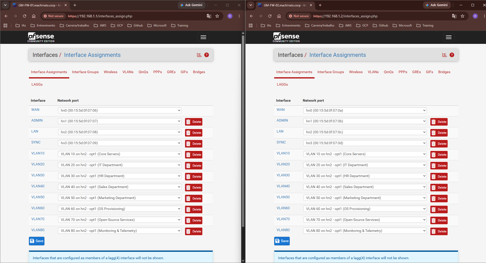
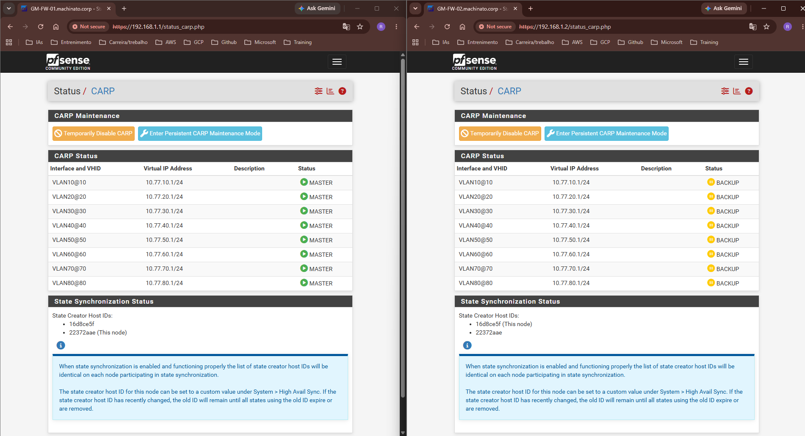
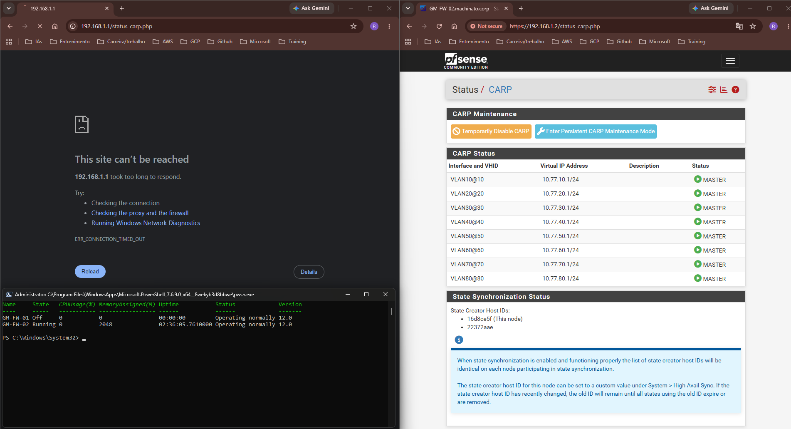
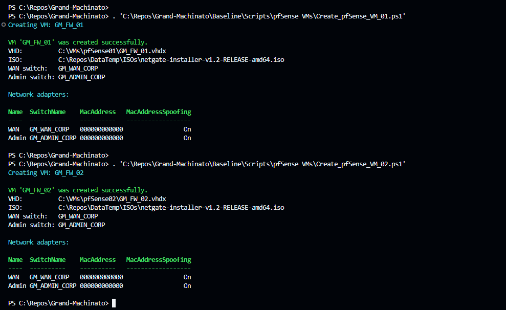
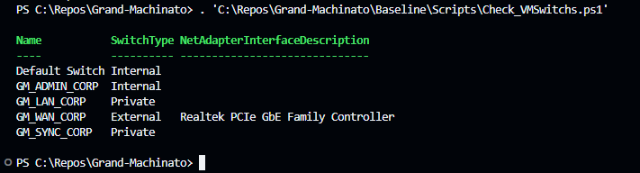

# Changelog

All notable changes, architectural milestones, and deployment evidence for the **Grand-Machinato** project are documented in this file.

---

## [0.2.1] - 11/10/2026 - Baseline: ADMIN and SYNC Interfaces added, VLANs created and FailOver Configured and functional

### Added (Features)

* **pfSense Interface Configuration:** Added and configured dedicated interfaces on both pfSense virtual machines:
  * **ADMIN:** Provides dedicated access to the pfSense WebGUI and administrative services.
  * **SYNC:** Provides a dedicated connection between the two pfSense nodes for High Availability synchronization.

* **VLAN Deployment:** Created and configured the required VLAN interfaces on both pfSense devices, ensuring consistent VLAN IDs, addressing, and network availability across the High Availability pair.

* **High Availability with CARP and pfsync:** Configured High Availability services on both pfSense devices:
  * **CARP:** Provides shared virtual IP addresses and assigns one node as `MASTER` and the other as `BACKUP`.
  * **pfsync:** Synchronizes firewall state information between the two nodes through the dedicated `SYNC` interface.
  * **Failover:** Validated functional failover so that the `BACKUP` node assumes the shared CARP virtual IP addresses when the `MASTER` node becomes unavailable.

* **Automated LAN Trunk Configuration:** Created a PowerShell (`Configure_VLAN_Trunking.ps1`) script that configures the LAN virtual network adapters of both pfSense VMs in **802.1Q trunk mode**, allowing the required tagged VLAN traffic to reach both devices.

* **CARP and VLAN Validation:** Verified that CARP correctly establishes one pfSense node as `MASTER` and the other as `BACKUP`, while the LAN trunk configuration allows the configured VLANs to operate across both nodes as expected.

### Evidence & Validation

#### Interfaces and VLANs created and configured

### Configured CARP Virtual IPs and `pfsync` over `GM_SYNC_CORP`

### FailOver working when one of the pfSense is down

## [0.2.0] - 11/09/2026 - Baseline: Virtual Network Machines Foundation

### Added (Features) - v0.2.0

* **pfSense Virtual Machines:** Created two dedicated pfSense virtual machines:
  * `GM-FW-01`
  * `GM-FW-02`

* **Automated VM Deployment:** Created two dedicated PowerShell (`Create_pfSense_VM_01.ps1`, `Create_pfSense_VM_02.ps1` ) scripts, one for each pfSense VM, to automate and assist with the virtual machine creation process.

* **VM Lifecycle & Management Scripts:** Added modular PowerShell scripts to manage the pfSense virtual machines:
  * **Activate VM:** Checks and activates the VM selected by the user. (`Check_activate_VMs.ps1`)
  * **Deactivate VM:** Checks and deactivates the VM selected by the user. (`Check_deactivate_VMs.ps1`)
  * **Rename VM:** Renames the VM selected by the user. (`Rename_VMs.ps1`)

* **VM Configuration Files (`pfSense_VM_01.json`, `pfSense_VM_02.json`):** Created two JSON configuration files, one for each pfSense VM, describing their respective VM structure and configuration.

### Evidence & Validation - v0.2.0

#### pfSense VMs Created

## [0.1.0] - 11/08/2026 — Baseline: Virtual Network Foundation

### Added (Features) - v0.1.0

* **Environment-Driven Automation (`.env`):** Centralized vSwitch naming and physical NIC binding variables in a root `.env` configuration file for portability.

* **Hyper-V Virtual Switches:** Automated the deployment of the four core network switches via PowerShell (`Baseline/Scripts/`):
  * `GM_WAN_CORP` (**External**): Bridged to the host physical network adapter (`AllowManagementOS` enabled) for outbound Internet access.
  * `GM_ADMIN_CORP` (**Internal**): Dedicated management interface (`192.168.1.0/24`) isolating host-to-pfSense WebGUI traffic.
  * `GM_LAN_CORP` (**Private**): Isolated trunk switch designated for internal 802.1Q department and server VLANs.
  * `GM_SYNC_CORP` (**Private**): Dedicated point-to-point link for pfSense High Availability state synchronization.

* **Lifecycle & Validation Scripts:** Added modular PowerShell scripts to create, verify, rename, and remove virtual switches (`Create_*_VMSwitch.ps1`, `Check_VMSwitch.ps1`, `Rename_VMSwitch.ps1`, and `Delete_VMSwitch.ps1`).

### Evidence & Validation -v0.1.0

#### vSwitches Created

