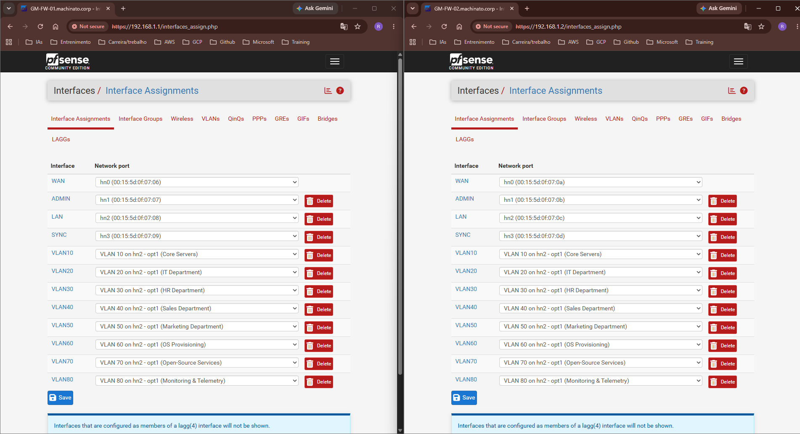
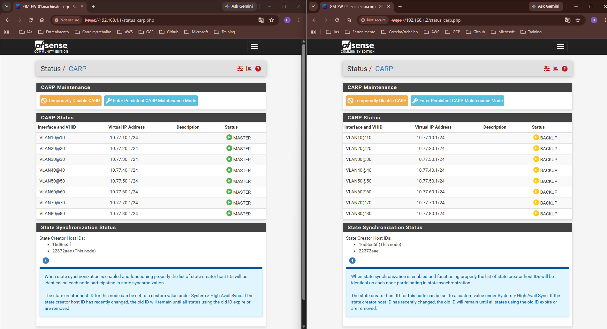
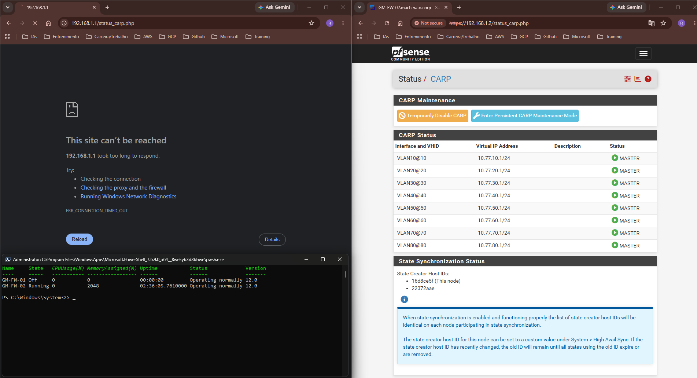
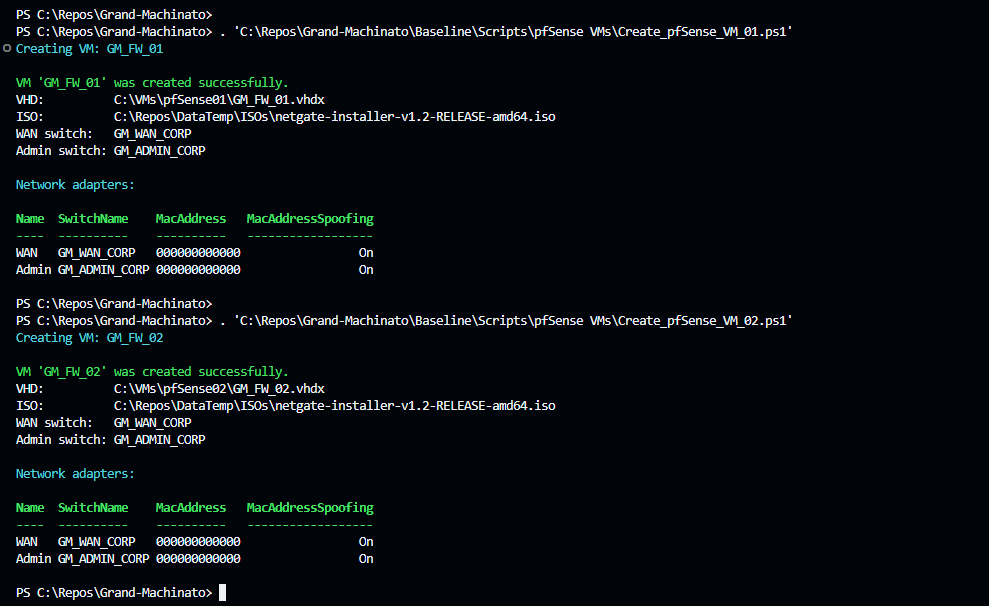
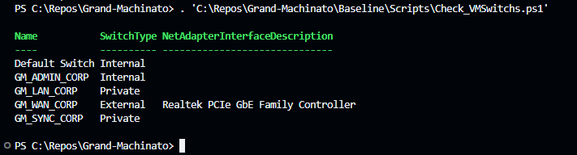

# Changelog

All notable changes, architectural milestones, and deployment evidence for the **Grand-Machinato** project are documented in this file.

---

## [0.2.2] - 11/21/2026 - Phase 1: Windows Server 2012 R2 and Initial Preparation

### Added (Features) - v0.2.2

- **Windows Server 2012 R2 Creation:** Created Windows Server VM creation script (`Create_WinServer_DC.ps1`), which sets the destined VM folder, name, ISO, creates the initial disk, sets up the memory, and assigns the network interface to `VLAN10`, along with three management utilities:
  - **Check_Add_SCSI_Controller.ps1:** Checks available VMs and their power state; if running, prompts the user to shut the VM down, lets the user create and attach a new SCSI Controller or attach an existing one, and offers to start the VM afterward.
  - **Check_Remove_SCSI_Controller.ps1:** Checks available VMs and their power state; if running, prompts the user to shut the VM down, lets the user select which SCSI Controller to remove, and offers to start the VM afterward.
  - **Check_DeleteVM.ps1:** Lists available VMs with their descriptions and prompts the user to confirm deletion.

- **Server Setup and Network Configuration:** Set up the Windows Server VM, renamed it to `GM-DC01`, and configured its static network settings:
  - **IP (Static):** `10.77.10.10`
  - **Network Mask:** `255.255.255.0`
  - **Default Gateway:** `10.77.10.1`
  - **DNS Servers:** `127.0.0.1`, `8.8.8.8` (updated to local loopback `127.0.0.1` once the AD DNS role was configured)

- **Server Edition Conversion:** Before promoting the server to a Domain Controller, converted the OS from Evaluation to Standard Edition to preserve future in-place upgrade compatibility:
  - `DISM /online /Get-CurrentEdition` (Verify current edition)
  - `DISM /online /Set-Edition:ServerStandard /ProductKey:D2N9P-3P6X9-2R39C-7RTCD-MDVJX /AcceptEula` (Convert to Standard Edition)

- **Domain Controller Setup and OU Structure:** Promoted `GM-DC01` as the root Domain Controller for `machinato.corp` (NetBIOS: `MACHINATO`) and built the base Active Directory Organizational Unit structure:
  - **Grand Machinato:** Root corporate OU containing all custom OUs.
  - **Administrators:** Dedicated privileged administrator accounts.
  - **Groups:** Security groups for department access and delegation.
  - **Servers:** Member server endpoints, subdivided into `Windows` and `Linux`.
  - **Service Accounts:** Non-human service and automation accounts.
  - **Workstations:** Client endpoints, subdivided into `IT`, `HR`, `Sales`, `Marketing`, and `Staging` (landing OU for newly deployed machines before moving to production department OUs).
  - **Users:** Employee user accounts, subdivided into `IT`, `HR`, `Sales`, and `Marketing`.

- **DHCP Service Configuration:** Configured DHCP Relay on `GM-FW-01` (synced via XMLRPC to `GM-FW-02`), bound to the `10.77.10.1` CARP Status VIP (`vhid 10`) with Option 82 (`Append circuit ID and agent ID`) enabled to forward DHCP requests to `10.77.10.10`. On `GM-DC01`, authorized the DHCP service in Active Directory and created active scopes for VLANs 20 through 60 (with global Option `006` DNS = `10.77.10.10` and Option `015` Domain = `machinato.corp`):
  - **VLAN20 (IT):** IP Range `10.77.20.10` – `10.77.20.100`, Mask `255.255.255.0`, Gateway `10.77.20.1`
  - **VLAN30 (HR):** IP Range `10.77.30.10` – `10.77.30.100`, Mask `255.255.255.0`, Gateway `10.77.30.1`
  - **VLAN40 (Sales):** IP Range `10.77.40.10` – `10.77.40.100`, Mask `255.255.255.0`, Gateway `10.77.40.1`
  - **VLAN50 (Marketing):** IP Range `10.77.50.10` – `10.77.50.100`, Mask `255.255.255.0`, Gateway `10.77.50.1`
  - **VLAN60 (Staging):** IP Range `10.77.60.10` – `10.77.60.100`, Mask `255.255.255.0`, Gateway `10.77.60.1`

- **DNS Service Configuration:** Configured Active Directory–integrated DNS on `GM-DC01` for internal resolution and external query forwarding:
  - **Forward Lookup Zone:** Validated `machinato.corp` with Active Directory SRV records and Host (`A`) record `gm-dc01.machinato.corp` pointing to `10.77.10.10`.
  - **Reverse Lookup Zones:** Created AD-integrated primary Reverse Lookup Zones for all eight corporate subnets (`10.77.10.in-addr.arpa` through `80.77.10.in-addr.arpa`) and verified `GM-DC01`'s `PTR` record (`10.77.10.10` -> `gm-dc01.machinato.corp`).
  - **External Forwarders:** Configured DNS Forwarders to `8.8.8.8` (`dns.google`) and `1.1.1.1` (`one.one.one.one`) with root hints fallback enabled, and removed external DNS servers from `GM-DC01`'s NIC.

- **Internet Information Services (IIS) and Legacy Intranet Setup:** Installed the Web Server (IIS) role with Static Content, Default Document, HTTP Errors, HTTP Redirection, and IIS Management Console to host the corporate legacy intranet:
  - **Web Application Deployment:** Deployed the custom static intranet portal created using copilot chat and copilot agents (`index.html`, `web.config`, custom error pages `not-found.html`/`access-denied.html`, department portals, and `assets`, `config`, `docs`, and `tools` directories) into `C:\inetpub\intranet`.
  - **Site Binding & DNS:** Created the `Legacy-Intranet` website in IIS Manager bound to port `80` with host header `intranet.machinato.corp`, and added the corresponding DNS `A` (and `PTR`) record pointing to `10.77.10.10`.

- **Windows Deployment Services (WDS) and Microsoft Deployment Toolkit (MDT) Integration Initial Setup:** Prepared the automated OS deployment pipeline on `GM-DC01` for cross-VLAN PXE imaging on `VLAN60`:
  - **WDS Role & Coexistence:** Installed and initialized WDS, enabled **Do not listen on DHCP ports** and **Configure DHCP options to indicate that this is also a PXE server** (Option `060`) to prevent UDP port `67` conflicts with the co-located DHCP Server, and configured PXE to respond to all clients.
  - **Cross-VLAN PXE Scope Options:** Configured the `VLAN60` (`10.77.60.0`) DHCP scope with Option `066` (`10.77.10.10`) and Option `067` (`boot\x64\wdsmgfw.efi`) to support UEFI Generation 2 Hyper-V VMs.
  - **MDT & Windows ADK Setup:** Disabled IE Enhanced Security Configuration (IE ESC) for Administrators, installed the Windows ADK, Windows PE Add-on, and Microsoft Deployment Toolkit (MDT), and initialized the Deployment Share.
  - **OS Image Conversion (`ESD` to `WIM`):** Extracted the Windows 10 `ESD-ISO` media onto the `D:` data volume (`D:\Win10-Source`) and exported the Windows 10 Pro index from `install.esd` to a standard `install.wim` using the Windows ADK `dism.exe` to enable MDT Operating System import.

### Evidence & Validation - v0.2.2

#### Windows Server 2012 R2 VM Creation and Configuration

#### Active Directory OU Structure (`machinato.corp`)

#### DNS Forward/Reverse Lookup Zones & Forwarders

#### pfSense HA DHCP Relay

#### DHCP Scopes and Options Configured on `GM-DC01`

#### IIS Legacy Intranet (`intranet.machinato.corp`)

#### Data Disk Creation and attachment on `GM-DC01`

#### WDS DHCP Coexistence & MDT Deployment Share

## [0.2.1] - 11/10/2026 - Baseline: ADMIN and SYNC Interfaces added, VLANs created and FailOver Configured and functional

### Added (Features) - v0.2.1

- **pfSense Interface Configuration:** Added and configured dedicated interfaces on both pfSense virtual machines:
  - **ADMIN:** Provides dedicated access to the pfSense WebGUI and administrative services.
  - **SYNC:** Provides a dedicated connection between the two pfSense nodes for High Availability synchronization.

- **VLAN Deployment:** Created and configured the required VLAN interfaces on both pfSense devices, ensuring consistent VLAN IDs, addressing, and network availability across the High Availability pair.

- **High Availability with CARP and pfsync:** Configured High Availability services on both pfSense devices:
  - **CARP:** Provides shared virtual IP addresses and assigns one node as `MASTER` and the other as `BACKUP`.
  - **pfsync:** Synchronizes firewall state information between the two nodes through the dedicated `SYNC` interface.
  - **Failover:** Validated functional failover so that the `BACKUP` node assumes the shared CARP virtual IP addresses when the `MASTER` node becomes unavailable.

- **Automated LAN Trunk Configuration:** Created a PowerShell (`Configure_VLAN_Trunking.ps1`) script that configures the LAN virtual network adapters of both pfSense VMs in **802.1Q trunk mode**, allowing the required tagged VLAN traffic to reach both devices.

- **CARP and VLAN Validation:** Verified that CARP correctly establishes one pfSense node as `MASTER` and the other as `BACKUP`, while the LAN trunk configuration allows the configured VLANs to operate across both nodes as expected.

### Evidence & Validation - v0.2.1

#### Interfaces and VLANs created and configured

### Configured CARP Virtual IPs and `pfsync` over `GM_SYNC_CORP`

### FailOver working when one of the pfSense is down

## [0.2.0] - 11/09/2026 - Baseline: Virtual Network Machines Foundation

### Added (Features) - v0.2.0

- **pfSense Virtual Machines:** Created two dedicated pfSense virtual machines:
  - `GM-FW-01`
  - `GM-FW-02`

- **Automated VM Deployment:** Created two dedicated PowerShell (`Create_pfSense_VM_01.ps1`, `Create_pfSense_VM_02.ps1` ) scripts, one for each pfSense VM, to automate and assist with the virtual machine creation process.

- **VM Lifecycle & Management Scripts:** Added modular PowerShell scripts to manage the pfSense virtual machines:
  - **Activate VM:** Checks and activates the VM selected by the user. (`Check_activate_VMs.ps1`)
  - **Deactivate VM:** Checks and deactivates the VM selected by the user. (`Check_deactivate_VMs.ps1`)
  - **Rename VM:** Renames the VM selected by the user. (`Rename_VMs.ps1`)

- **VM Configuration Files (`pfSense_VM_01.json`, `pfSense_VM_02.json`):** Created two JSON configuration files, one for each pfSense VM, describing their respective VM structure and configuration.

### Evidence & Validation - v0.2.0

#### pfSense VMs Created

## [0.1.0] - 11/08/2026 — Baseline: Virtual Network Foundation

### Added (Features) - v0.1.0

- **Environment-Driven Automation (`.env`):** Centralized vSwitch naming and physical NIC binding variables in a root `.env` configuration file for portability.

- **Hyper-V Virtual Switches:** Automated the deployment of the four core network switches via PowerShell (`Baseline/Scripts/`):
  - `GM_WAN_CORP` (**External**): Bridged to the host physical network adapter (`AllowManagementOS` enabled) for outbound Internet access.
  - `GM_ADMIN_CORP` (**Internal**): Dedicated management interface (`192.168.1.0/24`) isolating host-to-pfSense WebGUI traffic.
  - `GM_LAN_CORP` (**Private**): Isolated trunk switch designated for internal 802.1Q department and server VLANs.
  - `GM_SYNC_CORP` (**Private**): Dedicated point-to-point link for pfSense High Availability state synchronization.

- **Lifecycle & Validation Scripts:** Added modular PowerShell scripts to create, verify, rename, and remove virtual switches (`Create_*_VMSwitch.ps1`, `Check_VMSwitch.ps1`, `Rename_VMSwitch.ps1`, and `Delete_VMSwitch.ps1`).

### Evidence & Validation -v0.1.0

#### vSwitches Created

